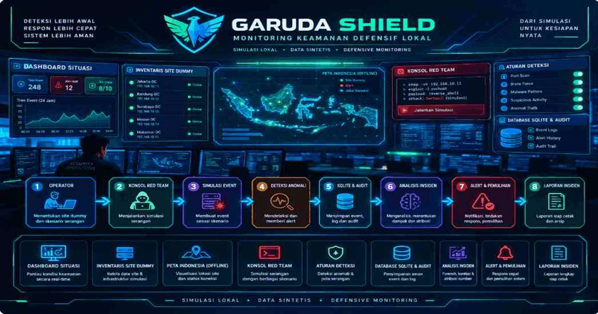
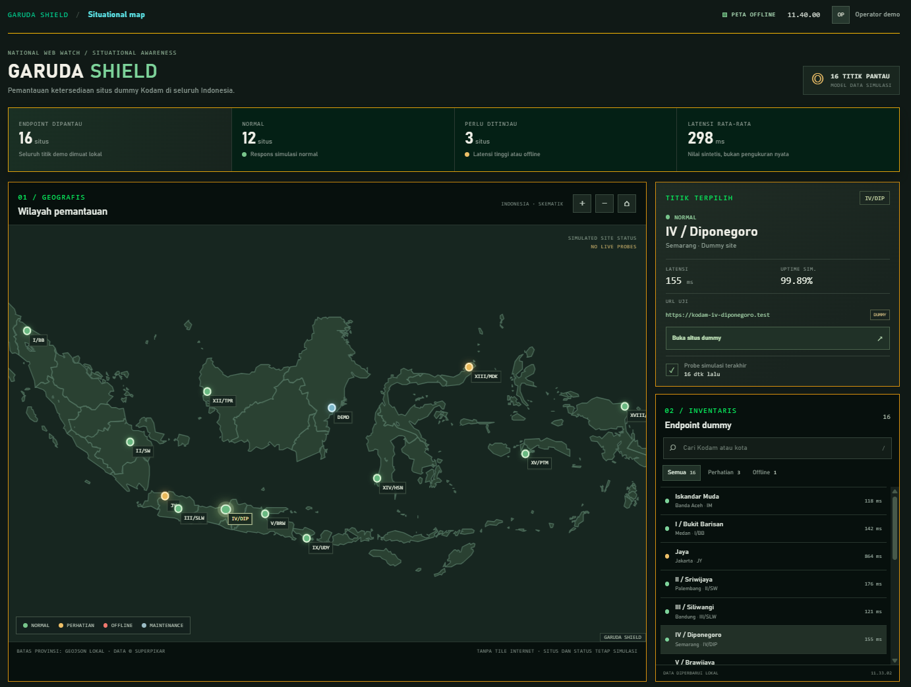
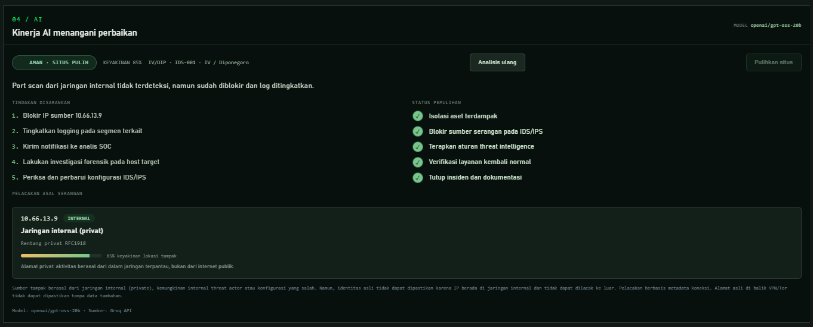
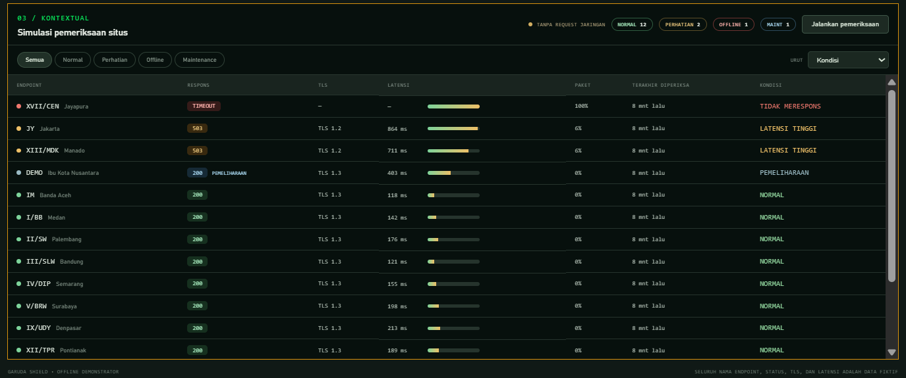
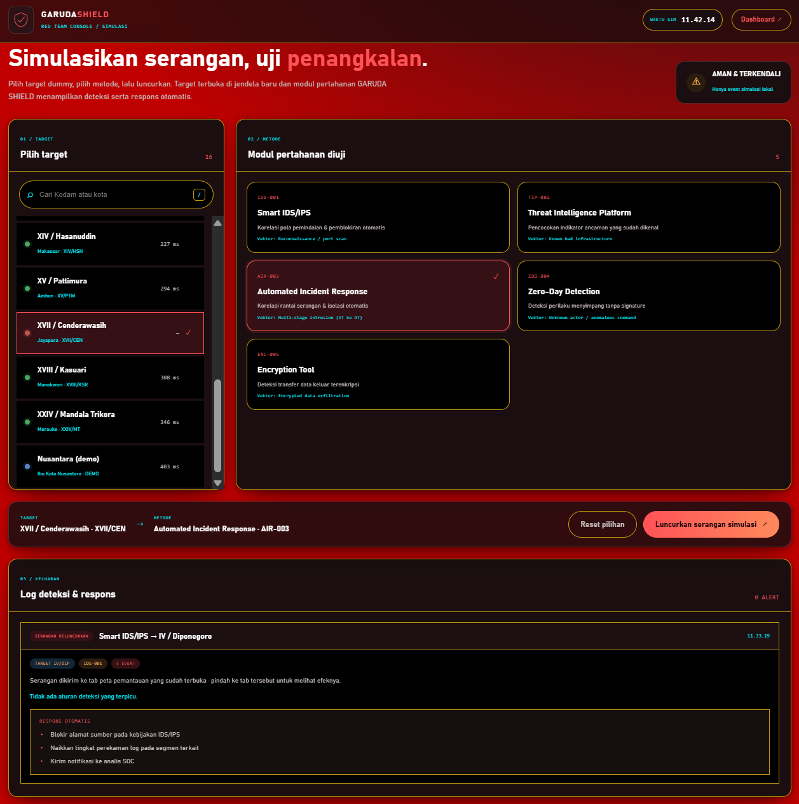
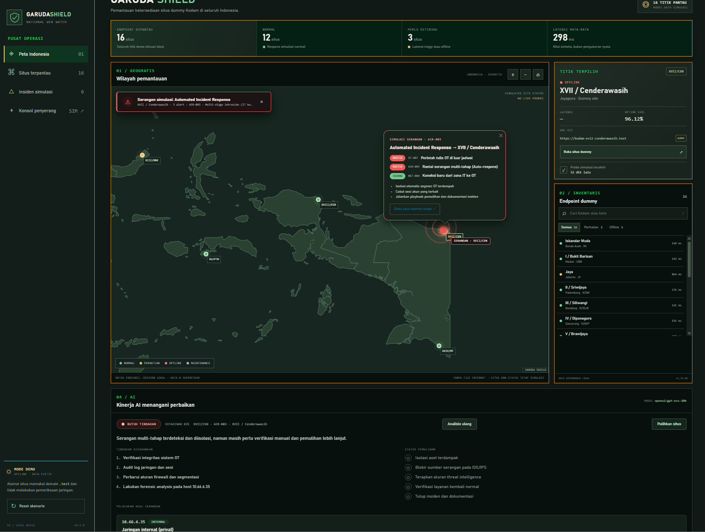
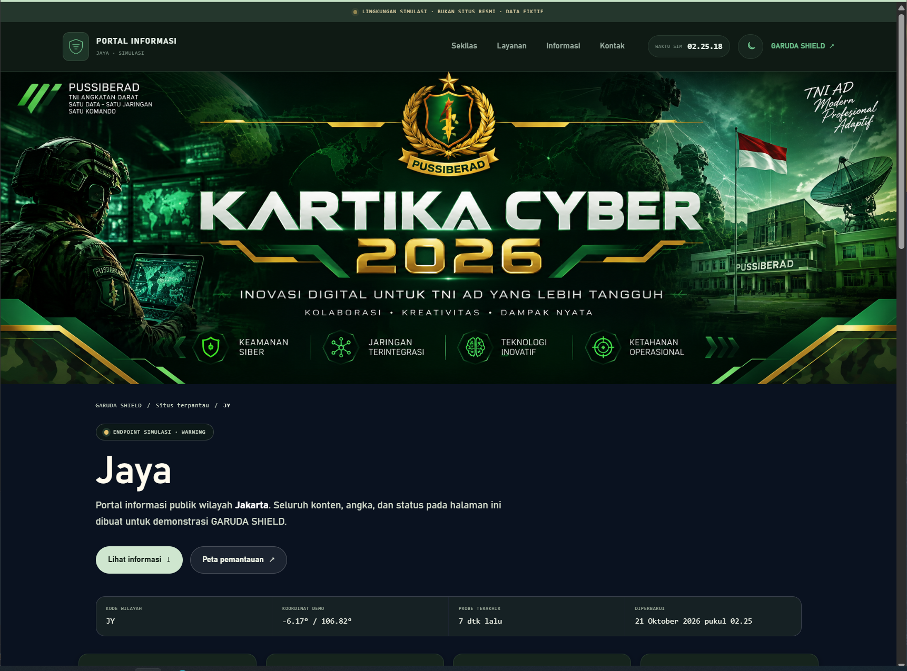
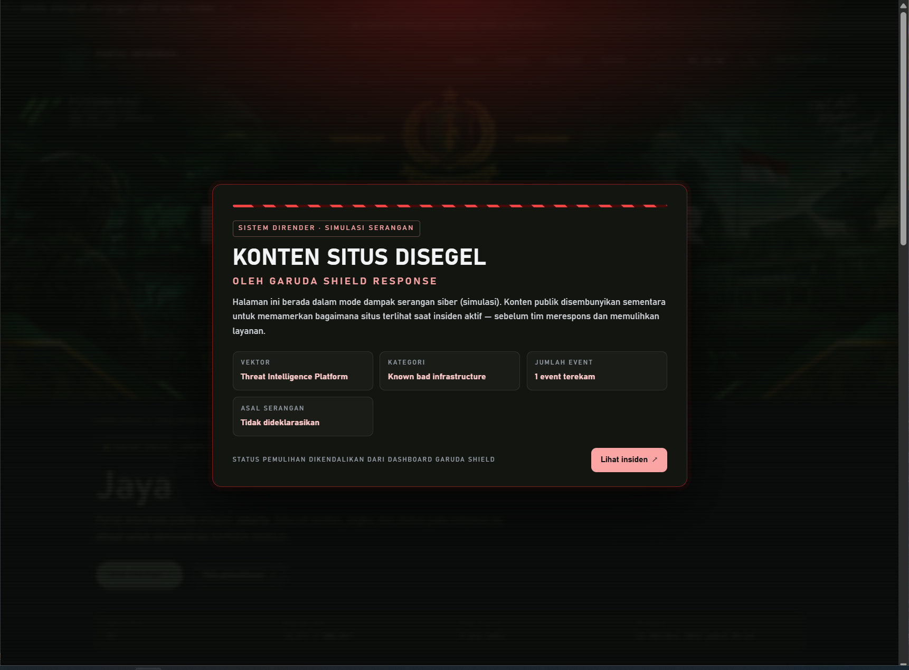
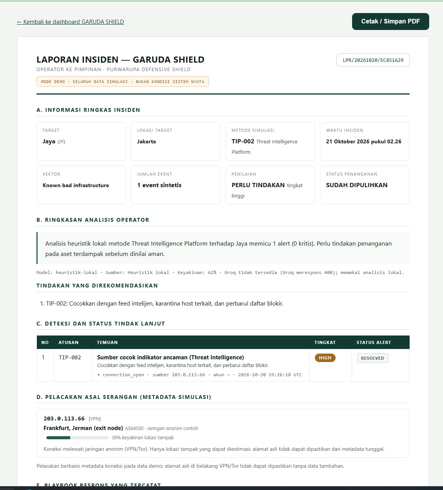

# GARUDA SHIELD


> **Purwarupa kategori Defensive Shield — pemantauan situs dummy IT/OT dengan peta offline, konsol simulasi serangan, rule engine deteksi, dan alur tindak lanjut insiden.**
>
> Kartika Cyber Hackathon 2026 · Pusat Siber Angkatan Darat (PUSSIBERAD) × CODEPOLITAN

GARUDA SHIELD adalah demonstrator yang memperlihatkan alur *event → deteksi → alert → tindak lanjut* dalam lingkungan yang aman, terkontrol, dan dapat diulang. Seluruh target, event, status, metrik, koordinat, dan hasil analisis adalah **data demo/sintetis** — aplikasi **tidak melakukan probe jaringan, pemindaian, pemblokiran, atau perubahan perangkat/jaringan** sama sekali.

---

## Fitur Utama

| Modul | Penjelasan |
|---|---|
| **Dashboard peta situasi** | 16 endpoint dummy (15 Kodam + 1 Nusantara) pada peta vektor Indonesia yang disajikan lokal — tanpa tile internet, tanpa server pihak ketiga. Sidebar inventaris dapat diciutkan untuk memperluas peta (tombol di kaki rail). |
| **Inventaris situs** | Pencarian, filter status (Normal / Perhatian / Offline / Maintenance), detail endpoint: latensi, uptime simulasi, URL `.test`, tautan situs dummy. |
| **Simulasi pemeriksaan situs** | Tabel pemeriksaan per endpoint (respons, TLS, latensi, kehilangan paket, kondisi) yang berjalan lokal tanpa request jaringan. |
| **Situs dummy interaktif** | Setiap situs (`/situs-dummy/:siteId`) punya halaman portal yang utuh: banner Kartika Cyber, hero, layanan, kabar simulasi, panel status endpoint, kontak — tema terang/gelap, semuanya data fiktif. |
| **Konsol Red Team + profil asal** | 5 modul pertahanan diuji: Smart IDS/IPS, Threat Intelligence Platform, Automated Incident Response, Zero-Day Detection, Encryption Tool. Panel "03 / ASAL PENYERANG" mensimulasikan IP asal, lokasi tampak, ISP, penanda VPN/Tor — serangan dibuat sebagai event sintetis, tidak ada paket ke target. |
| **Mode dampak serangan di situs dummy** | Situs yang diserang langsung memasuki mode *dirender* secara live: konten asli disamarkan (grayscale + blur), muncul layar penuh "KONTEN SITUS DISEGEL" berisi vektor serangan, jumlah event, dan asal penyerang (dengan penanda VPN/Tor); setelah pulih, efek hilang dan halaman kembali normal. Terpantau lewat render server pada `GET /situs-dummy/:siteId` dan polling `GET /api/insiden-aktif` (3 detik). |
| **Alarm insiden audio** | Sirine serangan udara mengulang saat insiden aktif (dapat dibisukan lewat tombol ALARM) — memutar file sirine lokal, fallback nada Web Audio jika autoplay diblokir browser. |
| **Rule engine deteksi** | Lonjakan login gagal (AUTH-001), koneksi IT→OT tanpa persetujuan (NET-004), tulis OT di luar jadwal (OT-007), pola pemindaian port (IDS-001), indikator ancaman (TIP-002), rantai serangan multi tahap (AIR-003), aktor tak dikenal (ZDD-004), eksfiltrasi terenkripsi (ENC-005). |
| **Panel AI penanganan insiden** | Analisis heuristik lokal (default) — status Aman/Butuh Tindakan, keyakinan, ringkasan, tindakan disarankan, checklist pemulihan, dan pelacakan asal serangan berbasis metadata. Tahapan kerja AI tampil beranimasi; analisis hanyalah penilaian, pemulihan tetap dikendalikan operator melalui tombol "Pulihkan situs". Integrasi Groq (opsional). |
| **Laporan insiden siap cetak** | Halaman `/laporan/:attackId` menyusun laporan operator → pimpinan, 9 bagian A–I: ringkasan insiden (A), analisis operator + tindakan (B), deteksi & status tindak lanjut (C), pelacakan asal serangan (D), playbook respons (E), **konteks jaringan: seluruh 16 situs Kodam dengan target ditandai (F)**, **riwayat serangan dalam sesi (G)**, jejak audit (H), pengesahan dua tanda tangan (I) — stempel "SELURUH DATA SIMULASI" pada kop, disclaimer di footer, serta tombol Cetak/Simpan PDF (Ctrl+P) tanpa dependensi tambahan. |
| **Audit & pemulihan** | Perubahan status alert tercatat di audit trail lokal; tombol "Pulihkan situs" mengeksekusi playbook langkah demi langkah, menuntaskan insiden, dan menghentikan alarm/animasi + mode dampak. |

## Cuplikan Layar

### 1. Dashboard Peta Situasi — gambaran menyeluruh seluruh wilayah



Halaman utama menampilkan KPI ringkas (16 situs dipantau, 12 normal, 3 perlu ditinjau, latensi rata-rata 298 ms), peta vektor Indonesia dengan penanda berwarna per status, panel detail situs terpilih (IV/Diponegoro — 155 ms, uptime 99,89%), serta inventaris endpoint dengan pencarian dan filter. Peta sepenuhnya dibangun dari GeoJSON lokal (`public/data/indonesia-province-simple.json`) dan Leaflet yang disajikan dari `public/vendor/leaflet/` — banjir tile ("TANPA TILE INTERNET") memastikan demo tetap berjalan offline.

### 2. Panel AI — hasil analisis insiden dan checklist pemulihan



Setelah insiden, panel AI menilai kondisi: **AMAN · SITUS PULIH**, keyakinan 85%, ringkasan berbahasa Indonesia (mis. "Port scan dari jaringan internal tidak terdeteksi, namun sudah diblokir dan log ditingkatkan"). Di sisi kiri tindakan yang disarankan (blokir IP 10.66.13.9, tingkatkan logging, notifikasi SOC, forensik, perbarui konfigurasi IDS/IPS); di sisi kanan kelima langkah pemulihan tercentang satu per satu. Pelacakan asal serangan menampilkan alamat internal RFC1918 beserta keyakinan lokasi dan catatan keterbatasannya — apa adunya jujur bahwa alamat di belakang VPN/Tor tidak dapat dipastikan dari metadata tunggal.

### 3. Simulasi pemeriksaan situs — tabel kondisi per endpoint



Tabel pemeriksaan menampilkan kondisi tiap endpoint: kode + kota, badge respons (200/503/TIMEOUT), versi TLS, latensi berikut bar grafiknya, persentase kehilangan paket, waktu pemeriksaan terakhir, dan label kondisi (NORMAL / LATENSI TINGGI / TIDAK MERESPONS / PEMELIHARAAN). Filter chip serta pengurutan (kondisi, latensi, nama, waktu) tersedia; tombol "Jalankan pemeriksaan" menganimasikan baris satu per satu — semuanya simulasi lokal, **tanpa request jaringan**.

### 4. Konsol Red Team — memicu skenario terhadap modul pertahanan



`/konsol` memilih target dummy (dari 16 situs, dengan pencarian dan filter latensi) lalu memilih salah satu dari 5 modul pertahanan yang diuji: **IDS-001** Smart IDS/IPS (port scan) — TERPILIH: **AIR-003** Automated Incident Response (intrusi multi tahap IT ke OT) — **TIP-002** Threat Intelligence Platform, **ZDD-004** Zero-Day Detection, **ENC-005** Encryption Tool (eksfiltrasi terenkripsi). Baris "Keluaran" menampilkan log serangan: modul → target, jumlah event, dan opsional setiap alert terpicu, serta "Respons otomatis" dari playbook mitigasi. Pita atas ("SIMULASI DEFENSIF · SERANGAN TIDAK NYATA · TARGET ADALAH SITUS DUMMY LOKAL") menegaskan aman dan terkendali.

### 5. Dashboard menerima serangan — deteksi, tindak lanjut, dan pemulihan



Saat serangan dilancarkan dari `/konsol`, dashboard memantau langsung: penanda merah muncul tepat di koordinat target dengan cincin denyut beranimasi; popup merangkum alert terpicu (mis. **OT-007** KRITIS, **AIR-003** KRITIS, **NET-004** SEDANG) lengkap dengan rekomendasi playbook; panel AI beralih ke **BUTUH TINDAKAN** dengan keyakinan, tindakan disarankan, dan status pemulihan; alarm sirine aktif; tombol **Cetak laporan ↗** membuka laporan insiden siap PDF. Pita merah "SIMULASI DEFENSIF" tetap menjelaskan bahwa seluruh serangan tidak pernah meninggalkan aplikasi.

### 6. Situs dummy dalam keadaan normal — portal yang utuh



Contoh: `http://localhost:3000/situs-dummy/kodam-jaya`. Halaman portal fiktif yang layak dipandang: banner KARTIKA CYBER 2026 di atas, breadcrumb ke dashboard, badge status endpoint, hero nama Kodam + fakta demo (kode wilayah, koordinat, probe terakhir), kartu statistik (uptime, latensi, layanan, kunjungan 24 jam), avis "DEMO ONLY" yang tegas menyatakan data fiktif, layanan cepat, daftar kabar simulasi dengan pencarian + filter, panel status endpoint (URL `.test`, HTTP, latensi), navigasi, dan kontak. Pita merah "LINGKUNGAN SIMULASI · BUKAN SITUS RESMI" selalu tampil paling atas. Tema terang/gelap tersedia via tombol bulan/matahari.

### 7. Situs dummy terdampak serangan — mode dirender



Begitu insiden aktif menargetkan situs tersebut (atau dilihat setelah serangan diluncurkan dari konsol), halaman berubah dramatis tanpa reload: konten portal digelapkan (grayscale + blur), layar penuh merah krisis menampilkan judul "KONTEN SITUS DISEGEL — OLEH GARUDA SHIELD RESPONSE", pita peringatan bergerak, dan fakta serangan: **VEKTOR** (nama metode), **KATEGORI**, **JUMLAH EVENT** terekam, **ASAL SERANGAN** (lokasi tampak + ISP + flag VPN/TOR). Tombol "Lihat insiden ↗" menjembatani ke dashboard. Pita meramaikan tetap menyatakan LINGKUNGAN SIMULASI — dampak ini murni datar visual demo, bukan defacement.

### 8. Pemulihan dan laporan insiden — dari operator ke pimpinan



Operator menekan **Pulihkan situs** di panel AI: langkah playbook tercentang satu per satu (isolasi, pembersihan, verifikasi, pemantauan, dokumentasi), status berubah ke **AMAN · SITUS PULIH**, alarm berhenti, dan halaman situs dummy kembali normal dengan toast "Situs web dipulihkan". Laporan (`/laporan/:attackId`) lalu menyusun dokumen resmi 9 bagian: ringkasan insiden, analisis operator + tindakan yang direkomendasikan, tabel alert + bukti event, pelacakan asal serangan dengan bilah keyakinan, playbook respons, **konteks jaringan seluruh 16 situs Kodam** (target ditandai chip TARGET), **riwayat serangan dalam sesi**, jejak audit penanganan, dan pengesahan dua tanda tangan — siap disimpan sebagai PDF via Ctrl+P untuk lampiran pimpinan.

---

## Cara Menjalankan

Persyaratan: **Node.js 22.13+** (memakai modul SQLite bawaan `node:sqlite`; versi minimal ini penting agar modul tidak lagi dianggap eksperimental).

```powershell
npm install     # paket: express 5 + ejs
npm test        # pengujian otomatis (node --test)
npm start       # menyalakan server di http://localhost:3000
```

Server mengikat ke `127.0.0.1:3000` (atur `PORT` bila port 3000 terpakai).

| Rute | Keterangan |
|---|---|
| `GET /` | Dashboard peta, KPI, alert, audit, tabel pemeriksaan. |
| `GET /konsol` | Konsol tim penyerang (simulasi). |
| `GET /situs-dummy/:siteId` | Detail situs dummy (domain `.test`) — memasuki mode dampak bila insiden untuk situs itu sedang aktif. |
| `POST /api/serangan` | Jalankan metode simulasi (lengkap dengan profil asal penyerang opsional), simpan event, kembalikan deteksi + tautan situs target. |
| `POST /api/events` | Ingest satu event standar (login, koneksi, protocol_write, dll). |
| `GET /api/insiden-aktif` · `GET /api/serangan/:id` | Baca insiden simulasi. |
| `POST /api/analisis` | Analisis insiden — heuristik lokal atau Groq (opsional). |
| `POST /api/pulihkan` | Tandai insiden pulih. |
| `GET /laporan` | Laporan kondisi normal siap cetak — dapat diakses kapan saja tanpa menunggu insiden (print browser untuk PDF). |
| `GET /laporan/:attackId` | Laporan insiden 9 bagian A–I siap cetak (operator ke pimpinan; print browser untuk PDF). |
| `POST /alerts/:id/status` · `POST /demo/reset` | Ubah status alert / reset data demo. |

Opsional: set `GROQ_API_KEY` (+ `GROQ_MODEL`) di `.env` untuk mengaktifkan analisis via Groq; tanpa environment variable, aplikasi tetap berjalan penuh memakai heuristik lokal.

## Struktur Proyek

```
src/              server Express 5 (server.js), SQLite via node:sqlite (db.js),
                  rule engine (detector.js), skenario konsol (threats.js),
                  pelacakan asal simulasi (geoip.js), data situs (kodam-sites.js), views EJS
public/           CSS/JS per halaman, Leaflet vendored, GeoJSON provinsi, suara alarm,
                  thumbnail situs (public/thumbs) + generator scripts/make-thumbs.js
data/             demo-events.json (seed) + SQLite lokal (dibuat otomatis, jangan dibagikan)
test/             pengujian rule engine dan konsistensi inventory (node --test)
docs/             proposal, dokumentasi teknis, naskah demo, slide, ceklist
```

## Batasan dan Keselamatan

- Seluruh target, koordinat, status, latensi, uptime, HTTP, TLS, dan sumber serangan adalah **data sintetis**.
- Bukan layanan monitoring produksi; tidak melakukan DNS lookup, HTTP probe, pemindaian, pemblokiran, atau perubahan perangkat/jaringan.
- Peta bersifat skematik (batas provinsi data © superpikar), bukan pemetaan operasional.
- Belum ada autentikasi/otorisasi produksi — **jangan dibuka ke jaringan publik**; jangan memasukkan data operasional atau rahasia.
- Mode dampak serangan merupakan efek visual demo; pita "LINGKUNGAN SIMULASI" selalu tampil agar konten tidak dikira defacement nyata.
- Sirine alarm: "Air Raid Siren" oleh orangefreesounds.com, lisensi **CC BY 4.0** — atribusi tercantum pada komentar elemen audio di `src/views/index.ejs`.

Dokumen pendukung lengkap ada di 
[`docs/`](docs/): 
- [ceklist.md](docs/ceklist.md)
- [proposal.md](docs/proposal.md)
- [technical.md](docs/technical.md)
- [demo-script.md](docs/demo-script.md)
- [presentation-slides.md](docs/presentation-slides.md)
- [Security Modules](docs/security-modules.md)
