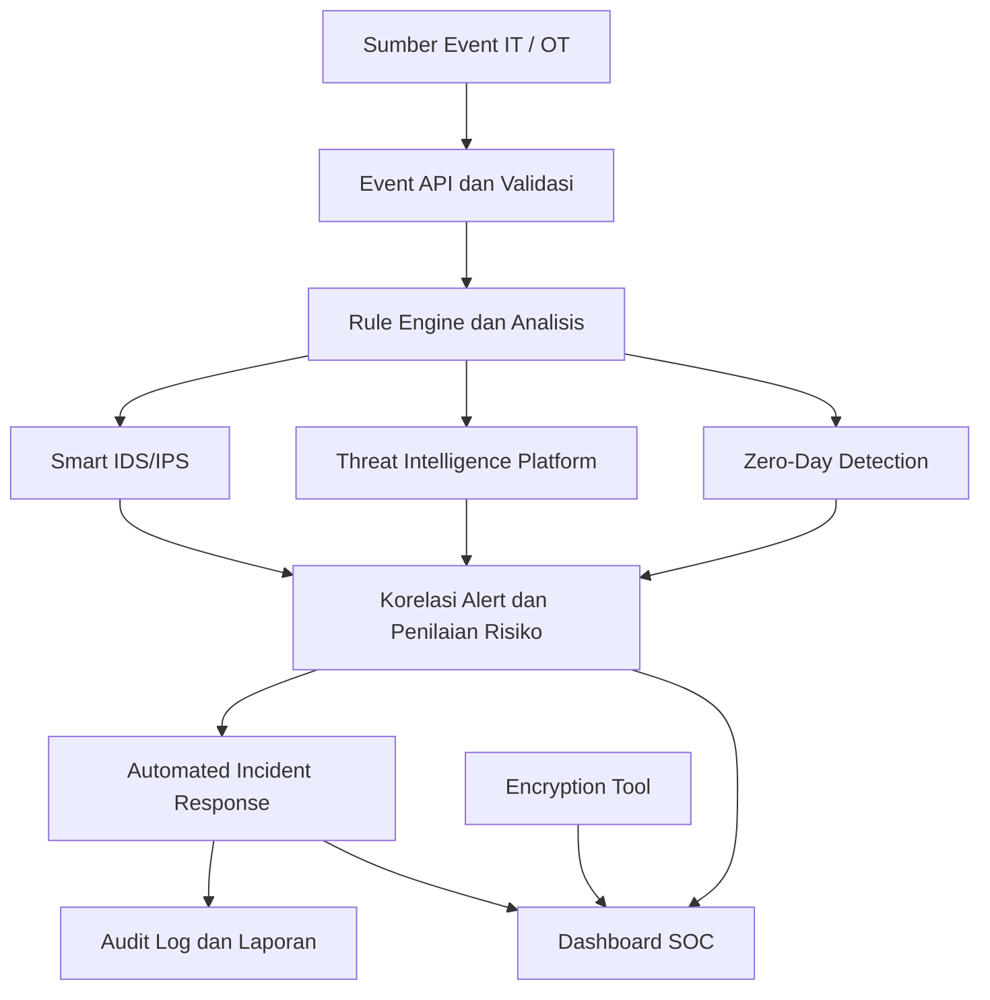
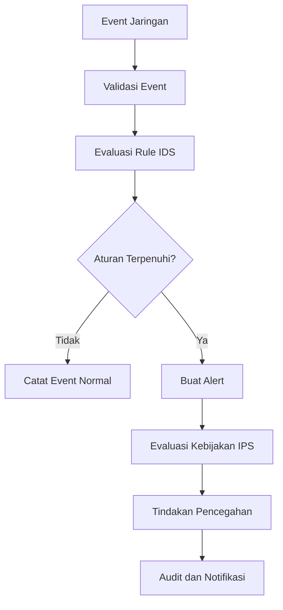
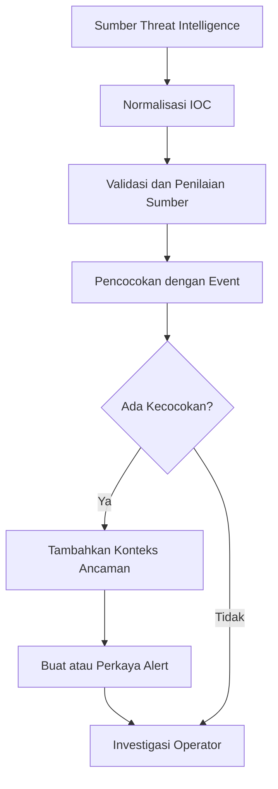
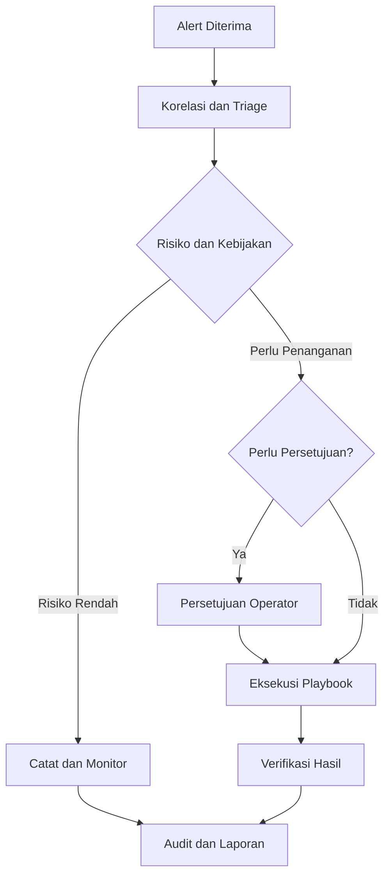
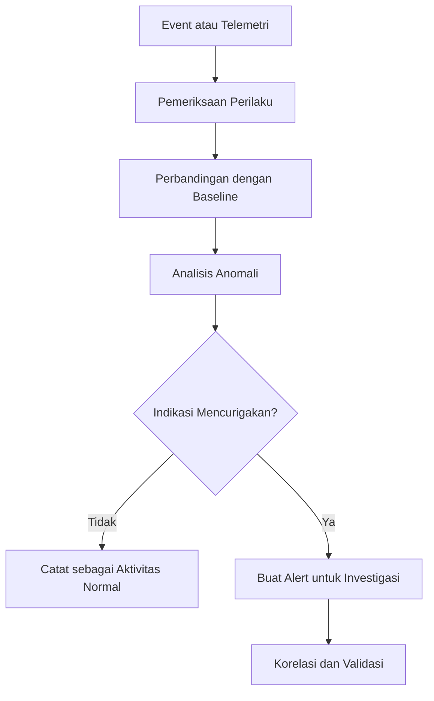
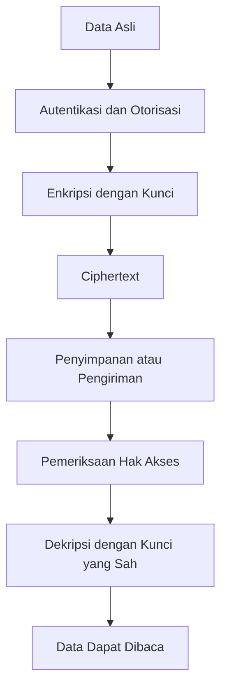

# GARUDA SHIELD — Security Modules

**KARTIKA CYBER 2026 | PUSSIBERAD**

Dokumentasi modul keamanan siber untuk platform GARUDA SHIELD, sebuah prototipe pemantauan, analisis ancaman, dan respons insiden yang dirancang untuk mendemonstrasikan konsep pertahanan siber pada lingkungan Information Technology (IT) dan Operational Technology (OT).

---

## 1. Overview

GARUDA SHIELD mengintegrasikan lima konsep utama keamanan siber ke dalam satu alur pemantauan dan analisis:

1. **Smart IDS/IPS** — mendeteksi pola intrusi dan mengevaluasi kebutuhan pencegahan.
2. **Threat Intelligence Platform (TIP)** — memperkaya analisis dengan indikator dan konteks ancaman.
3. **Automated Incident Response (AIR)** — mengoordinasikan langkah penanganan insiden berdasarkan aturan.
4. **Zero-Day Detection** — mendeteksi anomali yang berpotensi mengindikasikan ancaman baru.
5. **Encryption Tool** — mendukung pemahaman dan evaluasi perlindungan data menggunakan enkripsi.

Kelima modul bekerja sebagai bagian dari konsep pertahanan berlapis (*defense in depth*). Hasil analisis dari satu modul dapat digunakan sebagai konteks bagi modul lainnya.

> **Status implementasi:** GARUDA SHIELD merupakan prototipe demonstrasi dengan event sintetis. Keberadaan nama modul, aturan deteksi, dan skenario demo tidak dengan sendirinya membuktikan bahwa semua kemampuan keamanan telah diterapkan secara operasional. Status setiap kemampuan harus diverifikasi terhadap kode sumber, pengujian, dan integrasi yang tersedia.

## 2. Arsitektur Integrasi



Diagram tersebut merupakan gambaran konseptual integrasi. Diagram tidak berarti bahwa seluruh koneksi antarmodul telah tersedia dalam implementasi saat ini.

### Alur pemrosesan event

1. Event diterima melalui antarmuka API.
2. Sistem memvalidasi field wajib dan struktur event.
3. Rule engine memeriksa event terhadap aturan deteksi yang tersedia.
4. Sistem menghasilkan alert ketika kondisi aturan terpenuhi.
5. Alert ditampilkan untuk membantu analisis dan penentuan prioritas.
6. Jika respons otomatis telah dikonfigurasi dan diimplementasikan, sistem dapat menjalankan tindakan sesuai kebijakan.
7. Hasil penanganan dicatat untuk audit dan evaluasi.

### Format event

Contoh berikut merupakan data sintetis untuk demonstrasi.

```json
{
  "assetId": "IT-WS-001",
  "zone": "IT",
  "source": "network-monitor",
  "eventType": "port_scan",
  "sourceZone": "IT",
  "targetZone": "IT",
  "approved": false,
  "inMaintenanceWindow": false,
  "account": "demo-user",
  "occurredAt": "2026-10-21T02:00:00+07:00"
}
```

Field yang digunakan:

| Field | Keterangan |
|---|---|
| `assetId` | Identitas aset yang berkaitan dengan event |
| `zone` | Zona aset, yaitu `IT` atau `OT` |
| `source` | Sumber event |
| `eventType` | Jenis aktivitas yang dilaporkan |
| `sourceZone` | Zona asal aktivitas, jika tersedia |
| `targetZone` | Zona tujuan aktivitas, jika tersedia |
| `approved` | Informasi persetujuan aktivitas, jika tersedia |
| `inMaintenanceWindow` | Status jendela pemeliharaan |
| `account` | Akun terkait, jika tersedia |
| `occurredAt` | Waktu kejadian |

Event sintetis tidak boleh dianggap sebagai bukti bahwa aktivitas benar-benar terjadi pada jaringan produksi.

---

## 3. Smart IDS/IPS

### 3.1 Definisi

**Smart IDS/IPS** merupakan konsep sistem yang menggabungkan pendeteksian intrusi dengan mekanisme pencegahan aktivitas berbahaya.

IDS adalah *Intrusion Detection System*, sedangkan IPS adalah *Intrusion Prevention System*.

Keduanya mempunyai fungsi berbeda:

- **IDS:** mengidentifikasi aktivitas mencurigakan dan menghasilkan peringatan.
- **IPS:** selain mendeteksi, dapat mencegah atau menghentikan aktivitas tertentu melalui mekanisme penegakan kebijakan.
- **Smart detection:** memanfaatkan korelasi event, konteks aset, aturan, dan analisis anomali untuk meningkatkan kualitas deteksi.

Istilah Smart IDS/IPS tidak otomatis berarti sistem telah menggunakan AI atau machine learning. Kemampuan tersebut harus dibuktikan melalui implementasi.

### 3.2 Tujuan

Modul ini ditujukan untuk membantu:

- Mengenali pola pemindaian port.
- Mendeteksi aktivitas jaringan yang menyimpang dari kebijakan.
- Mengidentifikasi akses lintas zona IT/OT yang tidak sesuai aturan.
- Menghasilkan alert yang dapat ditindaklanjuti.
- Menyediakan konteks untuk investigasi insiden.

### 3.3 Alur kerja



Tindakan pencegahan pada diagram merupakan alur target. Pada prototipe yang hanya memproses event sintetis, sistem tidak boleh diklaim benar-benar memblokir koneksi jaringan.

### 3.4 Contoh skenario IT/OT

Sebuah event melaporkan pola pemindaian port terhadap aset IT.

1. Event diterima sistem.
2. Rule engine memeriksa karakteristik event.
3. Jika cocok dengan aturan pemindaian port, sistem menghasilkan alert.
4. Operator meninjau sumber, target, dan waktu kejadian.
5. Jika terintegrasi dengan IPS operasional, kebijakan pencegahan dapat dievaluasi sebelum diterapkan.

Dalam lingkungan OT, tindakan pemblokiran harus mempertimbangkan kebutuhan komunikasi industri, keselamatan, ketersediaan, dan persetujuan operator.

### 3.5 Contoh aturan deteksi

Nama aturan yang tercatat dalam skenario demonstrasi:

- `IDS-001` — pola pemindaian port.

Aturan tersebut merupakan identitas skenario deteksi. Kemampuan mendeteksi trafik jaringan secara langsung memerlukan sumber data jaringan dan mekanisme inspeksi yang sesuai.

### 3.6 Contoh hasil alert

```json
{
  "module": "Smart IDS/IPS",
  "ruleId": "IDS-001",
  "eventType": "port_scan",
  "severity": "high",
  "status": "detected",
  "action": "investigation_required"
}
```

Contoh ini adalah format ilustratif. Field, tingkat keparahan, dan nilai keluaran aktual harus disesuaikan dengan implementasi API.

### 3.7 Batasan

Deteksi berdasarkan event tidak sama dengan inspeksi paket jaringan secara langsung. IPS operasional membutuhkan integrasi dengan firewall, network enforcement, atau mekanisme lain yang sesuai.

---

## 4. Threat Intelligence Platform (TIP)

### 4.1 Definisi

**Threat Intelligence Platform** mengumpulkan, mengelola, dan menganalisis informasi ancaman untuk membantu organisasi memahami risiko keamanan siber.

TIP menghubungkan informasi indikator ancaman dengan event yang teramati di lingkungan organisasi.

### 4.2 Jenis informasi ancaman

**Indicators of Compromise (IOC)** dapat mencakup:

- Alamat IP yang terkait dengan aktivitas berbahaya.
- Domain yang digunakan untuk phishing atau distribusi malware.
- Hash file yang berkaitan dengan sampel malware.
- URL berbahaya.
- Pola dan teknik serangan yang telah didokumentasikan.

Sumber intelijen harus dinilai berdasarkan kualitas, waktu pembaruan, keandalan, dan konteksnya.

### 4.3 Alur kerja



### 4.4 Contoh skenario

Sebuah event sintetis menunjukkan koneksi menuju alamat IP tertentu.

1. Sistem menerima event koneksi.
2. TIP memeriksa apakah indikator terkait tersedia dalam sumber intelijen.
3. Jika ditemukan kecocokan, sistem menambahkan informasi pendukung.
4. Operator memeriksa reputasi sumber, waktu pembaruan, dan bukti tambahan.
5. Alert diprioritaskan berdasarkan konteks dan dampak potensial.

Satu kecocokan IOC tidak selalu membuktikan adanya serangan. Indikator dapat kedaluwarsa, digunakan bersama oleh banyak pihak, atau memiliki tingkat kepercayaan rendah.

### 4.5 Contoh aturan demonstrasi

- `TIP-002` — skenario indikator ancaman.

Aturan ini harus dibedakan dari integrasi TIP produksi yang mengambil, memperbarui, dan memvalidasi IOC dari sumber eksternal.

### 4.6 Informasi yang sebaiknya ditampilkan

- Jenis indikator dan nilainya.
- Sumber informasi.
- Waktu indikator diperoleh dan terakhir diperbarui.
- Tingkat kepercayaan.
- Event yang cocok.
- Alasan alert diprioritaskan.
- Status verifikasi operator.

### 4.7 Batasan

Jika prototipe hanya menggunakan indikator demo, jangan mengklaim telah terhubung dengan jaringan intelijen ancaman global secara real-time. Integrasi operasional membutuhkan sumber data, mekanisme pembaruan, validasi, dan pengelolaan indikator.

---

## 5. Automated Incident Response (AIR)

### 5.1 Definisi

**Automated Incident Response** mengotomatiskan sebagian proses penanganan insiden berdasarkan aturan, kebijakan, dan playbook yang telah ditetapkan.

AIR dapat menjadi bagian dari pendekatan SOAR (*Security Orchestration, Automation and Response*).

Tujuan utamanya adalah mengurangi keterlambatan respons, menjaga konsistensi penanganan, dan memastikan aktivitas respons dapat diaudit.

### 5.2 Tahapan respons

1. **Detection:** menerima alert dari sistem deteksi.
2. **Triage:** memeriksa tingkat keparahan dan konteks.
3. **Decision:** menentukan apakah tindakan otomatis diizinkan.
4. **Containment:** membatasi dampak jika tindakan tersebut tersedia dan aman.
5. **Recovery:** membantu pemulihan sesuai prosedur yang disetujui.
6. **Audit:** mencatat keputusan, pelaksana, hasil, dan waktu tindakan.

### 5.3 Alur kerja



Diagram ini menggambarkan alur target. Implementasi nyata harus memastikan bahwa tindakan yang ditampilkan benar-benar dijalankan dan hasilnya diverifikasi.

### 5.4 Contoh skenario

Sistem mendeteksi event yang mengindikasikan kemungkinan aktivitas berbahaya pada endpoint.

Respons yang dapat dirancang:

- Membuat tiket insiden.
- Mengirim notifikasi kepada petugas.
- Mengumpulkan bukti yang tersedia.
- Meminta persetujuan untuk isolasi endpoint.
- Mengisolasi endpoint jika integrasi, otorisasi, dan kebijakan memungkinkan.
- Mencatat hasil dan menyediakan prosedur pemulihan.

### 5.5 Contoh aturan demonstrasi

- `AIR-003` — skenario respons insiden otomatis.

Nama aturan tersebut tidak membuktikan bahwa tindakan pada perangkat sungguhan telah dijalankan. Status eksekusi harus ditampilkan secara eksplisit.

### 5.6 Pengamanan respons

Sebelum menjalankan tindakan otomatis, sistem perlu mempertimbangkan:

- Tingkat keparahan dan keyakinan deteksi.
- Identitas serta peran operator.
- Persetujuan untuk tindakan berisiko tinggi.
- Dampak terhadap layanan penting.
- Mekanisme pembatalan atau pemulihan.
- Audit trail yang tidak mudah dimanipulasi.

Untuk jaringan OT, tindakan yang memengaruhi komunikasi atau proses industri harus mengikuti prosedur operasional dan keselamatan yang berlaku.

### 5.7 Batasan

Membuat rekomendasi respons tidak sama dengan mengeksekusi respons. Integrasi operasional memerlukan koneksi ke sistem pengelolaan endpoint, firewall, identitas, tiket insiden, atau sistem lain yang relevan.

---

## 6. Zero-Day Detection

### 6.1 Definisi

**Zero-Day Detection** adalah pendekatan untuk menemukan aktivitas yang mungkin menunjukkan eksploitasi kerentanan yang belum diketahui atau belum memiliki perbaikan yang tersedia.

Karena signature untuk ancaman baru mungkin belum tersedia, pendekatan ini dapat memanfaatkan perilaku, anomali, indikator eksploitasi, dan korelasi beberapa sumber data.

### 6.2 Teknik yang relevan

**Behavioral analysis**

Menganalisis perilaku proses, akun, atau perangkat untuk menemukan aktivitas yang tidak sesuai pola normal.

**Anomaly detection**

Mengidentifikasi penyimpangan dari baseline aktivitas yang telah dibangun dari data yang relevan.

**Exploit behavior detection**

Mencari perilaku yang dapat menunjukkan eksploitasi, seperti eksekusi proses yang tidak biasa atau akses memori yang mencurigakan.

**Sandboxing**

Menganalisis file atau program mencurigakan dalam lingkungan terisolasi, apabila kemampuan tersebut tersedia.

Teknik-teknik ini dapat saling melengkapi, tetapi tidak menjamin semua serangan zero-day akan terdeteksi.

### 6.3 Alur kerja



### 6.4 Contoh skenario IT

Sebuah aplikasi yang biasanya menjalankan fungsi terbatas tiba-tiba memulai proses yang tidak lazim dan mencoba mengakses sumber daya sensitif.

Sistem dapat menandai perilaku tersebut untuk investigasi, meskipun belum tersedia signature yang cocok.

Alert tersebut merupakan indikasi yang memerlukan validasi, bukan bukti otomatis bahwa zero-day exploit telah terjadi.

### 6.5 Contoh aturan demonstrasi

- `ZDD-004` — skenario aktor atau aktivitas yang tidak dikenal.

**Pembedaan penting:** aktor yang tidak dikenal tidak sama dengan zero-day. Untuk mengklaim deteksi zero-day, implementasi harus memiliki telemetri yang relevan, metode analisis perilaku atau eksploitasi, dan pengujian yang menunjukkan kemampuan tersebut.

### 6.6 Pengembangan lanjutan

Kemampuan yang dapat ditambahkan:

- Baseline perilaku aset dan akun.
- Analisis urutan event.
- Integrasi endpoint telemetry.
- Korelasi dengan informasi kerentanan.
- Evaluasi false positive dan false negative.
- Pengujian menggunakan dataset atau simulasi yang terkontrol.

### 6.7 Batasan

Rule engine yang mendeteksi event tak dikenal hanya menunjukkan kemampuan mengenali kondisi tertentu. Sistem tersebut belum otomatis menjadi mesin deteksi zero-day berbasis AI atau machine learning.

---

## 7. Encryption Tool

### 7.1 Definisi

**Encryption Tool** adalah perangkat atau fungsi yang melindungi kerahasiaan data dengan mengubah plaintext menjadi ciphertext menggunakan algoritma dan kunci kriptografi.

Enkripsi merupakan bagian penting dari perlindungan data saat disimpan (*data at rest*) dan saat dikirimkan (*data in transit*).

### 7.2 Jenis enkripsi

**Symmetric encryption**

Menggunakan kunci yang sama untuk enkripsi dan dekripsi. AES merupakan contoh algoritma yang umum digunakan.

**Asymmetric cryptography**

Menggunakan pasangan kunci publik dan privat. RSA dan algoritma berbasis kurva eliptik merupakan contoh yang digunakan dalam skema kriptografi asimetris.

Dalam praktiknya, protokol modern sering menggabungkan kriptografi asimetris, pertukaran kunci, dan enkripsi simetris.

### 7.3 Alur perlindungan data



Diagram tersebut merupakan alur konseptual. Implementasi perlu menentukan algoritma, mode operasi, pengelolaan kunci, dan mekanisme autentikasi data.

### 7.4 Contoh penerapan

- Melindungi laporan insiden yang berisi data sensitif.
- Mengenkripsi file cadangan.
- Melindungi komunikasi melalui TLS.
- Mengamankan pertukaran informasi antar layanan.
- Membatasi akses terhadap data berdasarkan otorisasi.

### 7.5 Contoh aturan demonstrasi

- `ENC-005` — skenario eksfiltrasi atau transfer data terenkripsi.

Deteksi transfer terenkripsi berbeda dari melakukan enkripsi atau dekripsi data. Trafik terenkripsi dapat menjadi aktivitas sah, sehingga harus dinilai berdasarkan konteks, tujuan, volume, dan kebijakan.

### 7.6 Pengamanan kunci

Implementasi enkripsi yang aman perlu mempertimbangkan:

- Penyimpanan kunci secara aman.
- Pembatasan akses terhadap kunci.
- Rotasi dan pencabutan kunci.
- Backup dan prosedur pemulihan.
- Penggunaan algoritma serta pustaka kriptografi yang tepercaya.
- Perlindungan integritas dan autentikasi data.

### 7.7 Batasan

Mendeteksi pola transfer data terenkripsi tidak membuktikan bahwa sistem mampu mengenkripsi file. Fitur enkripsi operasional memerlukan implementasi kriptografi yang sesungguhnya serta pengujian pengelolaan kunci dan pemulihan data.

---

## 8. Integrasi Kelima Modul

Kelima modul dapat digunakan untuk menggambarkan siklus pertahanan berlapis:

| Tahap | Modul | Peran |
|---|---|---|
| 1 | Smart IDS/IPS | Mengidentifikasi pola intrusi dan mengevaluasi pencegahan |
| 2 | Threat Intelligence Platform | Memberikan konteks dan indikator ancaman |
| 3 | Zero-Day Detection | Menemukan anomali atau indikasi eksploitasi yang belum dikenal |
| 4 | Automated Incident Response | Mengatur proses respons berdasarkan kebijakan |
| 5 | Encryption Tool | Melindungi kerahasiaan data dan mendukung keamanan komunikasi |

Encryption Tool memiliki fungsi yang berbeda dari modul deteksi dan respons. Ia merupakan kontrol perlindungan data yang dapat mendukung keseluruhan arsitektur, bukan selalu langkah terakhir setelah respons insiden.

### Contoh alur investigasi

1. Event sintetis melaporkan aktivitas mencurigakan pada aset IT.
2. Smart IDS/IPS mencocokkan event dengan aturan yang tersedia.
3. TIP menambahkan konteks jika indikator ancaman yang relevan tersedia.
4. Zero-Day Detection dapat menandai perilaku abnormal jika didukung data dan metode analisis yang sesuai.
5. Sistem menggabungkan hasil tersebut untuk membantu operator menilai insiden.
6. Automated Incident Response mengusulkan atau menjalankan tindakan sesuai kemampuan yang benar-benar terintegrasi.
7. Encryption Tool melindungi data sensitif yang disimpan atau dikirim melalui mekanisme enkripsi yang tersedia.
8. Dashboard dan audit log menyajikan hasil serta jejak penanganan.

Alur ini adalah model konseptual. Tidak setiap event harus melewati seluruh modul, dan setiap integrasi harus diverifikasi pada implementasi.

---

## 9. Model Event IT/OT

GARUDA SHIELD menggunakan konsep pemisahan zona IT dan OT untuk membantu mengevaluasi konteks keamanan.

**Information Technology (IT)** mencakup sistem informasi, server, workstation, layanan bisnis, dan infrastruktur pengolahan data.

**Operational Technology (OT)** mencakup sistem yang memantau atau mengendalikan proses fisik, misalnya PLC, sistem kontrol industri, dan perangkat otomasi.

### Contoh skenario

| Skenario | Analisis yang relevan |
|---|---|
| Pemindaian port terhadap server | Smart IDS/IPS |
| Koneksi menuju IOC yang diketahui | Threat Intelligence Platform |
| Proses melakukan aktivitas abnormal | Zero-Day Detection |
| Insiden membutuhkan penanganan terkoordinasi | Automated Incident Response |
| Laporan insiden memuat data sensitif | Encryption Tool |

Akses lintas zona IT/OT tidak selalu berbahaya. Penilaian harus mempertimbangkan segmentasi jaringan, daftar komunikasi yang diizinkan, kebutuhan operasional, serta konteks pemeliharaan.

---

## 10. API dan Pengujian

Salah satu antarmuka event yang digunakan dalam prototipe adalah:

`POST /api/events`

Endpoint tersebut menerima satu event JSON sintetis, memvalidasi field wajib, menyimpan event, dan menghitung alert sesuai aturan yang tersedia.

Field wajib:

- `assetId`
- `zone` (`IT` atau `OT`)
- `source`
- `eventType`

Field opsional dapat mencakup `sourceZone`, `targetZone`, `approved`, `inMaintenanceWindow`, `account`, dan `occurredAt`.

### Pengujian yang direkomendasikan

1. Memastikan event valid dapat diterima dan disimpan.
2. Memastikan field wajib yang hilang ditolak.
3. Memastikan nilai zona yang tidak valid ditolak.
4. Memastikan timestamp yang tidak valid ditangani sesuai kebijakan API.
5. Memastikan aturan deteksi menghasilkan alert sesuai skenario.
6. Memastikan event yang tidak cocok dengan aturan tidak menghasilkan alert palsu.
7. Memastikan setiap respons insiden yang disimulasikan memiliki status yang jelas.
8. Memastikan catatan audit konsisten dengan tindakan yang benar-benar dijalankan.

Pengujian di atas merupakan rekomendasi validasi; hasilnya harus merujuk pada test suite yang benar-benar dijalankan.

---

## 11. Status Implementasi dan Roadmap

Gunakan status yang jelas untuk mencegah klaim berlebihan dalam presentasi dan dokumentasi.

| Kapabilitas | Status yang harus diverifikasi |
|---|---|
| Penerimaan dan validasi event sintetis | Tersedia sesuai endpoint dan pengujian |
| Rule engine dan skenario alert | Tersedia sesuai aturan yang diimplementasikan |
| IDS dengan trafik jaringan langsung | Memerlukan verifikasi integrasi |
| IPS yang benar-benar memblokir koneksi | Memerlukan integrasi enforcement |
| TIP dengan sumber IOC eksternal | Memerlukan verifikasi sumber dan pembaruan |
| Automated response ke sistem eksternal | Memerlukan verifikasi eksekusi dan audit |
| Deteksi zero-day berbasis perilaku | Memerlukan metode, telemetri, dan pengujian |
| Enkripsi serta dekripsi data aktual | Memerlukan implementasi dan pengujian kriptografi |

### Tahapan pengembangan

**Tahap 1 — Prototype**

- Penerimaan event sintetis.
- Rule engine.
- Alert dan dashboard.
- Demonstrasi alur insiden.
- Audit hasil simulasi.

**Tahap 2 — Integrasi**

- Pengumpulan log dan telemetri yang terotorisasi.
- Integrasi sumber threat intelligence.
- Pengayaan korelasi event.
- Playbook respons dengan persetujuan operator.
- Pengamanan penyimpanan dan komunikasi.

**Tahap 3 — Validasi operasional**

- Pengujian keamanan dan keandalan.
- Evaluasi false positive dan false negative.
- Validasi hak akses dan audit.
- Pengujian dampak terhadap layanan IT/OT.
- Prosedur pemulihan dan penanganan kegagalan.

---

## 12. Prinsip Keamanan dan Batasan Operasional

GARUDA SHIELD harus dikembangkan dengan prinsip berikut:

- **Defense in depth:** menggabungkan beberapa lapisan perlindungan.
- **Least privilege:** membatasi hak akses sesuai kebutuhan.
- **Human oversight:** mempertahankan pengawasan operator untuk tindakan berisiko tinggi.
- **Auditability:** mencatat keputusan dan hasil penanganan.
- **Safety first:** mempertimbangkan dampak terhadap sistem industri dan layanan penting.
- **Data protection:** melindungi informasi sensitif dan kunci kriptografi.
- **Evidence-based claims:** hanya mengklaim kemampuan yang telah dibuktikan oleh kode dan pengujian.

Prototipe demonstrasi tidak boleh digunakan sebagai pengganti sistem keamanan operasional tanpa proses rekayasa, integrasi, pengujian, dan persetujuan yang sesuai.

## 13. Kesimpulan

GARUDA SHIELD menggabungkan lima konsep keamanan siber untuk menggambarkan bagaimana deteksi, intelijen ancaman, analisis anomali, respons insiden, dan perlindungan data dapat saling mendukung.

Dokumentasi ini menjadi acuan konsep dan batasan setiap modul. Status implementasi aktual tetap ditentukan oleh kode sumber, konfigurasi, integrasi, dan hasil pengujian yang tersedia dalam repositori.

**KARTIKA CYBER 2026 — PUSSIBERAD**

*Demonstrating layered cyber defense through event-driven security monitoring and incident analysis.*
